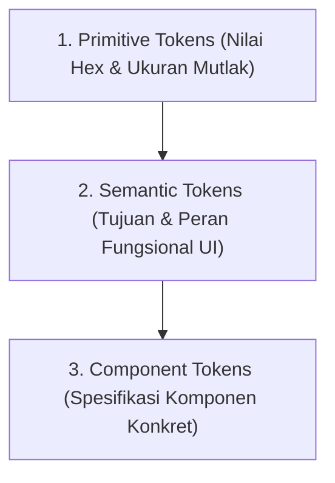

# Panduan Desain Sistem: VisitPekalongan

Dokumen ini adalah sumber kebenaran (*single source of truth*) untuk identitas visual, arsitektur token desain tiga lapis (*primitive, semantic, component*), spesifikasi komponen antarmuka, dan tipografi untuk platform **VisitPekalongan**.

---

## 1. Identitas & Filosofi Desain

- **Konsep Inti:** *Warm Artisanal Mori with Architectural Rigor* (Kehangatan Alami berpadu Presisi Kriya).
- **Inspirasi Visual:**
  - Kehangatan serat kain mori mentah sebelum proses pencelupan malam batik.
  - Palet tanah liat terakota dan kehangatan gerabah lokal.
  - Ketegasan garis presisi cetakan balok cap tembaga pembatik dan etiket kurasi museum.
- **Prinsip Utama:**
  1. **Anti-Pill & Presisi Geometri:** Menolak bentuk kapsul lonjong seragam pada kartu dan tombol. Menggunakan sudut ramping 6px hingga 8px untuk menghadirkan wibawa kriya yang kokoh.
  2. **Hairline Terdefinisi:** Menggunakan garis batas halus `1px solid` yang nyata daripada mengandalkan bayangan kabur melayang.
  3. **Kejujuran Warna & Kontras WCAG AA:** Seluruh teks dan elemen interaktif terkalibrasi lolos uji kontras minimum 4.5:1 di atas kanvas mori.

---

## 2. Arsitektur Tiga Lapisan Token (Three-Layer Tokens)

Sistem token disusun dalam 3 tingkatan hierarki untuk fleksibilitas tema dan pemeliharaan kode:



### A. Lapisan 1: Primitive Tokens (Nilai Hex Mutlak)

```css
:root {
  /* Nuansa Kanvas & Tanah */
  --primitive-mori-50:       #FCFAF7;
  --primitive-mori-100:      #F7F5F0; /* Kanvas Mori Utama */
  --primitive-clay-50:       #FAF8F5; /* Surface Kartu Utama */
  --primitive-clay-100:      #F2EFEB;
  --primitive-grout-200:     #E8E3DA;
  --primitive-grout-300:     #DDD6CA; /* Border Terdefinisi */
  --primitive-grout-400:     #C5BEB2;

  /* Nuansa Arang & Tipografi */
  --primitive-charcoal-900:  #242220; /* Teks Utama */
  --primitive-driftwood-600: #6E6963; /* Teks Sekunder */
  --primitive-driftwood-400: #9B948C;

  /* Nuansa Budaya & Alam */
  --primitive-terracotta-600: #A8472B; /* Aksen Teks (Kontras 5.05:1) */
  --primitive-terracotta-raw: #C86446; /* Latar Badge Aksen (Teks Putih) */
  --primitive-terracotta-subtle: #F5EAE6;
  --primitive-sage-700:       #48584A;
  --primitive-sage-600:       #5A6B5C; /* Sage Petungkriyono */
  --primitive-sage-subtle:    #ECF0EC;
  --primitive-roast-700:      #73472C;
  --primitive-roast-600:      #8C5A3C; /* Biji Kopi Sangrai */

  /* Status Fungsional */
  --primitive-moss-700:       #3E6D4B; /* Status Buka (Kontras 4.85:1) */
  --primitive-moss-subtle:    #EBF2ED;
  --primitive-brick-700:      #9E5345; /* Status Tutup */
  --primitive-brick-subtle:   #F7ECE9;

  /* Skala Geometri Ramping */
  --primitive-radius-xs:  2px;
  --primitive-radius-sm:  4px;
  --primitive-radius-md:  6px;
  --primitive-radius-lg:  8px;
  --primitive-radius-xl:  12px;
}
```

### B. Lapisan 2: Semantic Tokens (Tujuan UI Fungsional)

Token semantik memetakan nilai primitif ke peran antarmuka yang dipakai oleh Tailwind CSS v4 `@theme`:

```css
@theme {
  /* Latar Belakang & Permukaan */
  --color-canvas:            var(--primitive-mori-100);
  --color-surface:           var(--primitive-clay-50);
  --color-surface-elevated:  var(--primitive-mori-50);
  --color-surface-pure:      #FFFFFF;

  /* Garis Batas & Pemisah */
  --color-border:            var(--primitive-grout-300);
  --color-border-subtle:     var(--primitive-grout-200);
  --color-border-focus:      var(--primitive-terracotta-600);

  /* Tipografi */
  --color-text-primary:      var(--primitive-charcoal-900);
  --color-text-muted:        var(--primitive-driftwood-600);
  --color-text-subtle:       var(--primitive-driftwood-400);

  /* Aksen Berkarakter */
  --color-accent-terracotta: var(--primitive-terracotta-600);
  --color-accent-sage:       var(--primitive-sage-600);
  --color-accent-roast:      var(--primitive-roast-600);

  /* Status Operasional */
  --color-status-open-text:  var(--primitive-moss-700);
  --color-status-open-bg:    var(--primitive-moss-subtle);
  --color-status-closed-text: var(--primitive-brick-700);
  --color-status-closed-bg:  var(--primitive-brick-subtle);

  /* Sistem Radius Terstruktur */
  --radius-card:             var(--primitive-radius-lg);  /* 8px */
  --radius-button:           var(--primitive-radius-md);  /* 6px */
  --radius-badge:            var(--primitive-radius-sm);  /* 4px */
  --radius-drawer:           var(--primitive-radius-xl);  /* 12px (atas saja) */
}
```

### C. Lapisan 3: Component Tokens (Spesifikasi Komponen)

Spesifikasi langsung untuk setiap komponen antarmuka yang akan dibangun:

| Komponen | Properti Token | Nilai Semantic | Keterangan Desain |
| :--- | :--- | :--- | :--- |
| **Spot Card** | Background | `var(--color-surface)` | Clay krem `#FAF8F5` |
| | Border | `1px solid var(--color-border)` | Hairline terdefinisi `#DDD6CA` |
| | Radius | `var(--radius-card)` | 8px (sudut rapi, bukan gelembung) |
| | Shadow | `0 2px 8px -2px rgba(36,34,32,0.05)` | Bayangan pigmen tanah lembut |
| **Stamp Badge** | Background | `var(--color-surface-elevated)` | Krem pudar |
| | Border | `1px solid var(--color-border-subtle)` | Garis stempel halus |
| | Radius | `var(--radius-badge)` | 4px (persegi lembut, anti-kapsul) |
| | Padding | `3px 8px` | Padat dan hemat ruang |
| | Typography | Plus Jakarta Sans, 11px, Semi-bold | Gaya etiket kurasi arsip |
| **Nav/Utility Button** | Background | `var(--color-surface-pure)` | Putih bersih |
| | Border | `1px solid var(--color-border)` | Menyerupai instrumen fisik |
| | Radius | `var(--radius-button)` | 6px |
| | Active State | `var(--color-canvas)` | Tertekan alami |
| **Map Drawer** | Background | `var(--color-surface)` | Clay krem |
| | Top Border | `1px solid var(--color-border)` | Garis pemisah tegas dengan canvas peta |
| | Top Radius | `var(--radius-drawer)` | 12px pada kedua sudut atas |
| | Drag Handle | `36px x 4px`, bg `#C5BEB2`, radius 2px | Bar minimalis presisi |

---

## 3. Sistem Tipografi (Typography System)

### A. Pasangan Font (Font Pairing)
1. **Instrument Serif (Google Fonts):**
   - Peran: Headline, nama spot di halaman detail, judul header editorial.
   - Sifat: Berkelas, anggun, tajam pada ujung kait serif, mencerminkan narasi sastra dan warisan budaya.
2. **Plus Jakarta Sans (Google Fonts):**
   - Peran: Seluruh elemen antarmuka (label filter, harga, status buka, alamat, tombol aksi).
   - Sifat: Keterbacaan sangat tinggi (*high x-height*), modern, netral, dan nyaman untuk navigasi layar sentuh.

### B. Skala Tipe (Type Scale)

| Tingkat | Font Family | Ukuran / Line Height | Bobot | Penggunaan |
| :--- | :--- | :--- | :--- | :--- |
| **Display** | Instrument Serif | 36px / 42px (Mobile) ~ 48px / 56px (Desktop) | Regular 400 | Judul Beranda & Header Jurnal |
| **Heading 1** | Instrument Serif | 28px / 34px | Regular 400 | Nama Spot di Halaman Detail |
| **Heading 2** | Instrument Serif | 20px / 26px | Regular 400 | Nama Spot di Kartu Feed Grid |
| **Subhead** | Plus Jakarta Sans | 14px / 20px | Medium 500 | Signature Dish & Teritori Kecamatan |
| **Body UI** | Plus Jakarta Sans | 13px / 18px | Regular 400 | Deskripsi Ringkas & Jam Operasional |
| **Caption / Badge** | Plus Jakarta Sans | 11px / 14px | Semi-bold 600 | Lencana Kategori, Fasilitas, & Status |

---

## 4. Pola Aksesibilitas & Keandalan (Craftsmanship Standard)

- **Audit Kontras Warna (WCAG AA):**
  - Teks Charcoal `#242220` di atas Kanvas `#F7F5F0`: **14.2:1** (Lolos AAA).
  - Teks Driftwood `#6E6963` di atas Kanvas `#F7F5F0`: **4.99:1** (Lolos AA).
  - Teks Terracotta `#A8472B` di atas Kanvas `#F7F5F0`: **5.05:1** (Lolos AA).
  - Teks Status Buka `#3E6D4B` di atas Kanvas `#F7F5F0`: **4.85:1** (Lolos AA).
- **Target Ketukan Jari (Tap Targets):**
  Seluruh tombol aksi dan pil filter memiliki ukuran sentuh minimum `44px x 44px` atau pembungkus area klik (*hit-area wrapper*) yang memenuhi standar ergonomi seluler.
- **Indikator Fokus Keyboard:**
  Setiap elemen interaktif yang menerima fokus tombol `Tab` menampilkan garis tepi fokus `2px solid var(--color-border-focus)` dengan offset `2px`.

