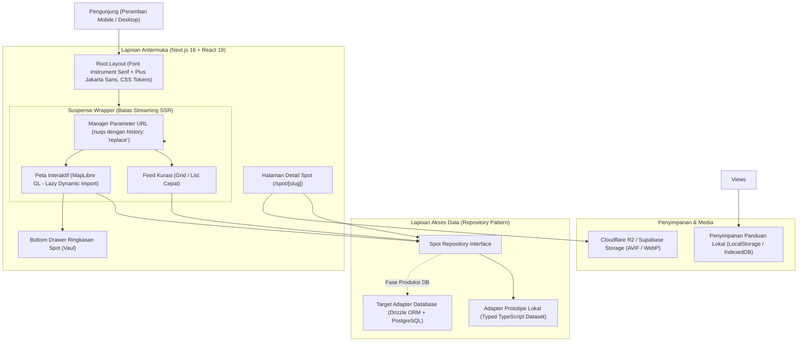

# Arsitektur Teknis: VisitPekalongan

Dokumen ini mendefinisikan arsitektur sistem, strategi rendering, optimasi performa seluler, manajemen state, dan alur data teknis untuk platform **VisitPekalongan**.

---

## 1. Ikhtisar Arsitektur Sistem

VisitPekalongan dibangun menggunakan arsitektur web modern berbasis Next.js App Router. Sistem dirancang dengan prinsip *mobile-first*, latensi rendah, serta pemisahan tegas antara logika server dan interaktivitas klien.



---

## 2. Strategi Rendering & Komponen (Next.js 16 + React 19)

### A. Pembagian Peran Komponen & Suspense Boundary

Pada Next.js 16 dan React 19, seluruh komponen klien yang mengonsumsi parameter URL (`useSearchParams` atau pustaka `nuqs`) wajib dibungkus dalam boundary `<Suspense>`. Hal ini mencegah de-optimasi halaman menjadi *client-side only* dan mempertahankan keunggulan *streaming SSR*.

| Komponen | Tipe | Alasan & Perilaku |
| :--- | :--- | :--- |
| `app/layout.tsx` | Server Component | Memuat font web via `next/font/google`, metadata SEO, dan CSS tokens global. |
| `app/page.tsx` | Server Component Shell | Mengambil data awal kurasi dan membungkus feed dalam `<Suspense fallback={<FeedSkeleton />}>`. |
| `components/feed/SpotFilter.tsx` | Client Component | Membaca dan memperbarui query URL dengan konfigurasi `{ history: 'replace', shallow: true }`. |
| `components/map/SpotMap.tsx` | Client Component (Lazy) | Dimuat melalui `next/dynamic` dengan `{ ssr: false }` hanya saat tab peta diaktifkan oleh pengguna. |
| `components/feed/SpotCard.tsx` | Presentational Component | Kartu visual dengan optimasi gambar `next/image` rasio 4:3 dan lencana status operasional waktu nyata. |
| `app/spot/[slug]/page.tsx` | Server Component | Halaman detail dengan metadata Open Graph lengkap untuk pratinjau tautan WhatsApp/Twitter. |

### B. Isolasi Lazy Loading MapLibre GL
Pustaka MapLibre GL beserta asset worker WebGL berukuran sekitar 800 KB hingga 1 MB. Agar ukuran ini tidak membebani First Contentful Paint (FCP) pengunjung utama:
- Kode peta diisolasi total di dalam file `components/map/SpotMapLazy.tsx`.
- Komponen hanya diimpor saat pengguna secara eksplisit mengetuk tombol toggle tampilan "Peta".
- Pengunjung yang hanya menelusuri daftar feed kartu tidak akan mengunduh aset peta sama sekali.

### C. Isolasi Gestur Mobile (Map vs Vaul Drawer)
Ketika pengguna membuka laci bawah ringkasan spot (*bottom drawer*) di atas peta:
- State `isDrawerDragging` diaktifkan saat gestur drag laci dimulai.
- Kontainer canvas peta diberi kelas dinamis `pointer-events-none` untuk mencegah canvas WebGL ikut tergeser atau ter-zoom secara tidak sengaja (*touch event bleeding*).
- Area konten laci bawah menerapkan CSS `touch-action: pan-y`, sedangkan bar handle laci menerapkan `touch-action: none`.

---

## 3. Manajemen State & Sinkronisasi URL (`nuqs`)

Seluruh state interaktif disinkronkan ke parameter URL peramban untuk menghasilkan tautan kurasi yang dapat dibagikan langsung via WhatsApp.

### Aturan Sanitasi & History Browser
1. **Pencarian Teks & Viewport Peta (`?q=`, `?lat=`, `?lng=`):**
   Wajib menggunakan opsi `{ history: 'replace', shallow: true }`. Hal ini mencegah tombol *Back* pada ponsel terjebak dalam riwayat input ketukan tuts huruf demi huruf.
2. **Pergantian Kategori & Tampilan (`?category=`, `?view=`):**
   Dapat menggunakan opsi `{ history: 'push' }` agar navigasi tombol kembali peramban mengembalikan pengguna ke kategori sebelumnya secara logis.
3. **Penyaringan Nilai Default:**
   Parameter yang kembali ke status awal (misal kolom pencarian kosong) otomatis dihapus dari URL string untuk menjaga kebersihan tautan yang disalin.

---

## 4. Lapisan Abstraksi Data (Repository Pattern)

Untuk memfasilitasi kebutuhan prototipe cepat yang tetap mematuhi skema basis data produksi kelak, aplikasi menggunakan pola Repository Interface.

### Kontrak Repository (`src/lib/repositories/spot-repository.ts`):

```typescript
export interface SpotRepository {
  // Kueri ringan khusus marker peta (< 15 KB payload)
  getMapMarkers(filter?: SpotFilterParams): Promise<SpotMapMarkerDTO[]>;
  
  // Kueri daftar kartu feed
  getSpots(filter?: SpotFilterParams): Promise<SpotListItemDTO[]>;
  
  // Kueri ulasan detail mendalam per slug
  getSpotBySlug(slug: string): Promise<SpotDetailDTO | null>;
}
```

1. **Tahap 1 (Prototipe Terstruktur):**
   Repository mengonsumsi dataset lokal TypeScript (`src/data/spots.ts`) yang divalidasi dengan skema Zod. Hal ini menjamin bahwa seluruh properti (koordinat, jam buka harian multi-shift, fasilitas, foto) identik dengan struktur tabel PostgreSQL target.
2. **Tahap 2 (Migrasi Database):**
   Implementasi repository diganti menjadi kueri Drizzle ORM menuju PostgreSQL (Supabase / Neon) tanpa perlu mengubah satu baris pun kode pada komponen tampilan antarmuka.

---

## 5. Strategi Ketahanan Lapangan di Pegunungan Petungkriyono

Lereng pegunungan Petungkriyono memiliki kawasan hutan lindung dengan titik *blank spot* seluler total. Upaya melakukan cache vector tiles peta MapLibre secara penuh rawan menghasilkan tampilan layar abu-abu kosong (*missing gray tiles*) di tengah hutan.

### Solusi Pragmatis yang Diterapkan:
1. **Paket Panduan Mandiri Petungkriyono (Offline Text Guide):**
   Satu tombol simpan yang mengunduh data kurasi seluruh spot Petungkriyono ke `IndexedDB` lokal:
   - Deskripsi teks ulasan dan patokan arah rute (contoh: *"200 meter setelah Jembatan Rogojembangan, belok kiri ke jalan berbatu"*).
   - Nomor kontak darurat basecamp wisata lokal dan pengelola curug.
   - Jam buka dan tips persiapan fisik/kendaraan.
2. **Navigasi Rute Native Intent:**
   Tombol navigasi rute diarahkan ke URI intent native:
   `https://www.google.com/maps/dir/?api=1&destination=${lat},${lng}`
   Format ini memungkinkan aplikasi peta native di ponsel pengguna (seperti Google Maps Offline Area atau OsmAnd) mengambil alih panduan navigasi tanpa bergantung pada koneksi internet web browser.
3. **Indikator Status Jaringan:**
   Banner pemberitahuan halus (*network recovery banner*) yang muncul otomatis saat koneksi internet terputus, memberi tahu pengguna bahwa aplikasi beralih ke mode data tersimpan lokal.

---

## 6. Pipeline Optimasi Aset & Media (LCP & CLS Control)

- **Format Media:** Seluruh foto kurasi dikonversi ke format AVIF dan WebP dengan kompresi terukur.
- **Rasio Aspek:**
  - Kartu Feed: 4:3 (fokus pada estetika komposisi foto suasana tempat).
  - Galeri Detail: 16:10 dan 4:3.
- **Atribut Ukuran Responsif (`sizes`):**
  Untuk mencegah unduhan gambar berukuran desktop pada layar seluler:
  `sizes="(max-width: 640px) 100vw, (max-width: 1024px) 50vw, 33vw"`
- **Low-Quality Image Placeholder (LQIP):**
  Menggunakan inline base64 blur placeholder berukuran mikroskopis (~500 bytes) untuk mencegah pergeseran tata letak kumulatif (*Cumulative Layout Shift / CLS*) dan menjaga LCP tetap di bawah 1.8 detik pada koneksi 3G/4G.

---

## 7. Topologi Lingkungan & Deployment

- **Platform:** Vercel Serverless Platform.
- **Node.js Runtime:** Node 20 LTS.
- **Analitik & Metrik:** Vercel Speed Insights dan Core Web Vitals monitoring.
