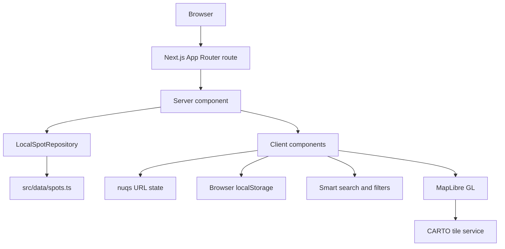

# Architecture

This document describes the current runtime architecture. It does not describe planned database or backend work.

## System shape



The application has no API route, database adapter, authentication layer, or server mutation in the current repository.

## Rendering boundaries

| Area | Rendering | Responsibility |
| --- | --- | --- |
| Root layout | Server component | Loads fonts, metadata, global CSS, the `nuqs` adapter, and the intro overlay. |
| Home page | Server component shell | Calls the repository and passes categories and spots to the feed. |
| Feed explorer | Client component | Keeps URL filters, search state, pagination, saved-spot state, and view selection. |
| Map loader | Client component | Uses `next/dynamic` with `ssr: false` for the MapLibre map. |
| Detail page | Server component | Fetches a spot, builds metadata and JSON-LD, and calculates related spots. |
| Detail actions | Client component | Runs share, bookmark, and mobile action-bar behavior. |
| Report page | Server component shell with a client form | Renders the form, then stores a submission in the browser. |

## Home page data flow

`src/app/page.tsx` calls:

```ts
spotRepository.getCategories()
spotRepository.getSpots()
```

The repository reads `CATEGORIES` and `SPOTS_DATA` from `src/data/spots.ts`. The home page sends the results to `SpotFeedExplorer`.

The client feed filters the list in this order:

1. category;
2. city or regency;
3. open-now status;
4. saved-spot list;
5. debounced smart search.

The feed then slices the result into pages of nine items. The map receives the filtered list when the user selects map view.

## Detail page data flow

`src/app/spot/[slug]/page.tsx` calls `getSpotBySlug` and `getSpots`. It returns a not-found page when the slug is missing or points to a permanently closed spot.

The detail page uses `getRecommendedSpots` to rank other spots by:

- category match;
- geographic distance;
- shared facilities;
- price range.

The opening status is calculated in client components with `calculateOpenStatus` and the shared `useNow` hook. The calculation uses the `Asia/Jakarta` timezone and supports shifts that cross midnight.

## Map loading

`SpotMapLazy` imports `SpotMap` through `next/dynamic` with `ssr: false`. The MapLibre worker is served from `public/maplibre-gl-worker.mjs`.

The map style URL is:

```text
https://basemaps.cartocdn.com/gl/positron-gl-style/style.json
```

When `NEXT_PUBLIC_CARTO_API_KEY` is set, the application appends it as a `key` query parameter.

The repository contains a `getMapMarkers` method, but the current map consumes `SpotListItemDTO[]`. The marker method is not used by a route.

## URL state

`useSpotFilters` uses `nuqs` and `history: replace` for all current query parameters. The current parameters are:

- `q`;
- `category`;
- `regency`;
- `openNow`;
- `saved`;
- `view`;
- `spot`.

The `spot` parameter is exposed by the hook but is not passed to the map or used to select a marker.

## Browser state

The application uses `localStorage` for:

- bookmark slugs;
- recent search strings;
- report-form submissions.

Each hook uses `useSyncExternalStore` or a local event so multiple components can react to changes. These values are not persisted on a server.

## Styling and configuration

- Global tokens are defined in `src/app/globals.css`.
- `next.config.ts` enables `cacheComponents`, `partialPrefetching`, and `reactCompiler`.
- Tailwind CSS 4 is loaded through `@tailwindcss/turbopack`.
- The root layout uses `Instrument_Serif` and `Plus_Jakarta_Sans` from `next/font/google`.
- The document uses a fixed light visual theme. There is no working theme toggle.

## Responsive scroll model

The current layout treats small and large screens differently:

- Below the `md` breakpoint, the document uses normal page scrolling and the header stays sticky at the top.
- At `md` and above, the root document is locked to the viewport and the application content scrolls inside the page container.
- The scroll-lock utility blocks the root document and the application scroll container while the intro or filter dialog is active.

This behavior lives in `src/app/globals.css` and the page shells. It affects where a scrollbar appears, not the filter or search logic.

## Intro overlay and scroll lock

The root layout renders `PortalIntroOverlay`. The overlay:

- locks document scrolling while it is active;
- marks the application content as inert;
- completes after the visual timeline, a watchdog timer, Escape, or an interaction;
- respects the reduced-motion media query.

The scroll-lock utility counts nested locks and restores the previous overflow values when the final lock is released.

## Related documents

- [Data model](data-model.md)
- [User flows](user-flows.md)
- [Routes and SEO](routes-and-seo.md)
- [Design system](../DESIGN.md)
