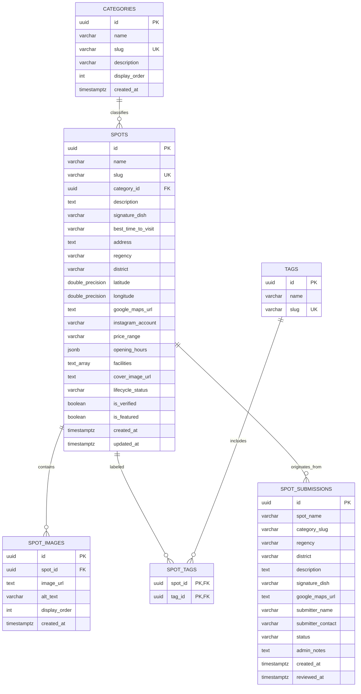

# Desain Basis Data: VisitPekalongan

Dokumen ini mendefinisikan skema basis data relasional, kamus data lengkap, tipe data kompleks (JSONB), standarisasi enum, serta strategi indeks performa untuk platform **VisitPekalongan**.

---

## 1. Diagram Relasi Entitas (Entity Relationship Diagram)

Sistem dirancang menggunakan PostgreSQL dengan pemodelan relasional yang efisien, mendukung kueri filter multibaris, status siklus hidup data, serta pembagian wilayah administratif yang tegas:



---

## 2. Rincian Tabel & Kamus Data

### A. Tabel: `categories`
Menampung pengelompokan pilar kurasi utama (contoh: Coffee, Kuliner Khas, Wisata Alam, Heritage).

| Kolom | Tipe Data | Keterangan |
| :--- | :--- | :--- |
| `id` | `UUID` (PK) | Default: `gen_random_uuid()` |
| `name` | `VARCHAR(100)` | Nama kategori tampilan, Not Null |
| `slug` | `VARCHAR(100)` | Slug unik untuk URL, Not Null, Unique |
| `description` | `VARCHAR(255)` | Penjelasan singkat pilar kurasi |
| `display_order` | `INTEGER` | Urutan penataan tab, Default: 0 |
| `created_at` | `TIMESTAMPTZ` | Waktu pencatatan, Default: `NOW()` |

### B. Tabel: `spots`
Menyimpan entitas inti setiap lokasi yang terdaftar.

| Kolom | Tipe Data | Keterangan |
| :--- | :--- | :--- |
| `id` | `UUID` (PK) | Default: `gen_random_uuid()` |
| `name` | `VARCHAR(150)` | Nama tempat, Not Null |
| `slug` | `VARCHAR(150)` | URL ramah SEO, Not Null, Unique |
| `category_id` | `UUID` (FK) | Relasi ke `categories.id`, Not Null |
| `description` | `TEXT` | Narasi kurasi ulasan suasana dan sejarah, Not Null |
| `signature_dish` | `VARCHAR(150)` | Menu khas yang wajib dicoba (contoh: "Kopi Tahlil Rempah") |
| `best_time_to_visit`| `VARCHAR(150)` | Waktu terbaik berkunjung (contoh: "Kabut sore jam 15:30") |
| `address` | `TEXT` | Alamat fisik lengkap, Not Null |
| `regency` | `VARCHAR(20)` | Teritori makro: `'kota'` atau `'kabupaten'`, Not Null |
| `district` | `VARCHAR(100)` | Nama kecamatan baku (lihat Bagian Standarisasi Wilayah), Not Null |
| `latitude` | `DOUBLE PRECISION`| Titik lintang koordinat geografis, Not Null |
| `longitude` | `DOUBLE PRECISION`| Titik bujur koordinat geografis, Not Null |
| `google_maps_url` | `TEXT` | Tautan navigasi Google Maps, Not Null |
| `instagram_account`| `VARCHAR(100)` | Handle akun Instagram resmi (tanpa @) |
| `price_range` | `VARCHAR(20)` | Klasifikasi harga lokal (`murah_meriah`, `terjangkau`, `kafe_spesial`), Not Null |
| `opening_hours` | `JSONB` | Jadwal operasional multi-slot terstruktur (lihat Bagian 3A), Not Null |
| `facilities` | `TEXT[]` | Daftar fasilitas aktif (contoh: `{'wifi', 'power_plug'}`), Default: `'{}'` |
| `cover_image_url` | `TEXT` | URL foto utama representatif tempat, Not Null |
| `lifecycle_status` | `VARCHAR(30)` | Status siklus hidup (`active`, `temporarily_closed`, `permanently_closed`), Default: `'active'` |
| `is_verified` | `BOOLEAN` | Status verifikasi oleh tim kurator, Default: true |
| `is_featured` | `BOOLEAN` | Penanda tempat rekomendasi khusus, Default: false |
| `created_at` | `TIMESTAMPTZ` | Waktu pembuatan data, Default: `NOW()` |
| `updated_at` | `TIMESTAMPTZ` | Waktu pembaruan data, Default: `NOW()` |

### C. Tabel: `spot_images`
Menyimpan galeri foto suasana pendukung.

| Kolom | Tipe Data | Keterangan |
| :--- | :--- | :--- |
| `id` | `UUID` (PK) | Default: `gen_random_uuid()` |
| `spot_id` | `UUID` (FK) | Relasi ke `spots.id` dengan aturan `ON DELETE CASCADE`, Not Null |
| `image_url` | `TEXT` | URL file foto terkompresi (AVIF/WebP), Not Null |
| `alt_text` | `VARCHAR(200)` | Teks deskripsi aksesibilitas visual |
| `display_order` | `INTEGER` | Urutan penataan foto dalam galeri, Default: 0 |
| `created_at` | `TIMESTAMPTZ` | Waktu pembuatan data, Default: `NOW()` |

### D. Tabel: `tags` & `spot_tags`
Mendukung filter suasana (*vibe*) yang fleksibel.

- **`tags`:**
  - `id` (`UUID`, PK, `gen_random_uuid()`)
  - `name` (`VARCHAR(50)`, Not Null) : Contoh: "Adem", "WFC Friendly", "Malam Hari", "Spot Senja"
  - `slug` (`VARCHAR(50)`, Not Null, Unique)
- **`spot_tags`:**
  - `spot_id` (`UUID`, FK -> `spots.id` ON DELETE CASCADE)
  - `tag_id` (`UUID`, FK -> `tags.id` ON DELETE CASCADE)
  - Primary Key Gabungan: `(spot_id, tag_id)`

### E. Tabel: `spot_submissions` (Lapor Hidden Gem)
Menampung rekomendasi tempat baru dari warga lokal.

| Kolom | Tipe Data | Keterangan |
| :--- | :--- | :--- |
| `id` | `UUID` (PK) | Default: `gen_random_uuid()` |
| `spot_name` | `VARCHAR(150)` | Nama tempat usulan warga, Not Null |
| `category_slug` | `VARCHAR(100)` | Kategori yang diusulkan, Not Null |
| `regency` | `VARCHAR(20)` | `'kota'` atau `'kabupaten'`, Not Null |
| `district` | `VARCHAR(100)` | Kecamatan lokasi tempat, Not Null |
| `description` | `TEXT` | Alasan mengapa tempat ini layak dikurasi, Not Null |
| `signature_dish` | `VARCHAR(150)` | Menu atau daya tarik khas yang direkomendasikan |
| `google_maps_url` | `TEXT` | Tautan navigasi Google Maps, Not Null |
| `submitter_name` | `VARCHAR(100)` | Nama warga pengusul |
| `submitter_contact`| `VARCHAR(100)` | Email atau nomor WhatsApp pengusul |
| `status` | `VARCHAR(20)` | Status moderasi (`pending`, `approved`, `rejected`), Default: `'pending'` |
| `admin_notes` | `TEXT` | Catatan verifikasi internal kurator |
| `created_at` | `TIMESTAMPTZ` | Waktu pengajuan, Default: `NOW()` |
| `reviewed_at` | `TIMESTAMPTZ` | Waktu peninjauan kurator |

---

## 3. Tipe Data Terstruktur & Standarisasi Enum

### A. Format Jam Buka Multi-Slot (`opening_hours` JSONB)

Untuk mengakomodasi realitas usaha kuliner lokal Pekalongan (shift pagi dan sore, jeda istirahat Sholat Jumat, serta operasional malam hingga dini hari), struktur data menggunakan array `slots`:

```typescript
export interface TimeSlot {
  open: string;  // Format jam 24 jam "HH:mm", misal "06:00" atau "18:30"
  close: string; // Format jam 24 jam "HH:mm", misal "11:00" atau "02:30"
}

export interface DaySchedule {
  slots: TimeSlot[]; // Array slot waktu untuk mendukung split-shift dan jeda Jumat
  is_closed: boolean; // Bernilai true jika tutup seharian
}

export interface WeeklyOpeningHours {
  monday: DaySchedule;
  tuesday: DaySchedule;
  wednesday: DaySchedule;
  thursday: DaySchedule;
  friday: DaySchedule;
  saturday: DaySchedule;
  sunday: DaySchedule;
  notes?: string; // Contoh: "Khusus Jumat tutup sementara saat ibadah Sholat Jumat"
}
```

*Contoh Kasus Nyata Warung Makan Megono Sor Gayam:*
- Jumat: slot 1 (06:00 - 11:15), slot 2 (13:00 - 21:00). Jeda Sholat Jumat tercermin secara otomatis dan akurat.

### B. Siklus Hidup Tempat (`lifecycle_status`)

- `active` : Beroperasi normal dan buka sesuai jadwal rutin.
- `temporarily_closed` : Tutup sementara (renovasi berkala, masa berkabung pemilik, atau libur musiman Syawalan/Krapyakan). Tempat tetap ada di direktori dan bookmark pengguna tidak rusak, namun berlabel "Tutup Sementara".
- `permanently_closed` : Usaha telah tutup permanen (dikecualikan dari feed publik, namun catatan histori relasi tetap terjaga).

### C. Standarisasi Fasilitas (`facilities`)

Pilihan fasilitas terstandarisasi untuk filter dan lencana pada kartu:
- `wifi` : Akses WiFi stabil
- `power_plug` : Ketersediaan stopkontak ramah laptop
- `outdoor_smoking` : Area luar ruangan / merokok
- `air_conditioned` : Ruangan sejuk berpendingin udara (AC)
- `prayer_room` : Fasilitas mushola
- `car_parking` : Lahan parkir mobil
- `motorcycle_parking` : Lahan parkir sepeda motor
- `scenic_view` : Pemandangan alam / sungai / sawah

### D. Standarisasi Wilayah Administratif (`regency` & `district`)

- **Regency: `kota` (Kota Pekalongan):**
  - `pekalongan_barat`
  - `pekalongan_timur`
  - `pekalongan_utara`
  - `pekalongan_selatan`
- **Regency: `kabupaten` (Kabupaten Pekalongan):**
  - `petungkriyono` (Kawasan Hutan Lindung, Curug, & Kopi)
  - `doro` (Sentra Durian & Perbukitan)
  - `kajen` (Pusat Pemerintahan)
  - `wiradesa` (Jalur Pantura & Kuliner Khas)
  - `kedungwuni` (Sentra Batik & Konveksi)
  - `karanganyar` (Wisata Lembah & Pinus)

### E. Klasifikasi Harga Lokal (`price_range`)

- `murah_meriah` : Di bawah Rp 15.000 per porsi (contoh: Megono legendaris, Kopi Tahlil).
- `terjangkau` : Rp 15.000 hingga Rp 35.000 per menu (contoh: Soto Tauto komplit, Garang Asem, es kopi susu).
- `kafe_spesial` : Di atas Rp 35.000 per orang (contoh: Biji kopi specialty manual brew, makanan utama kafe modern).

---

## 4. Strategi Indeks & Performa Kueri

1. **Kueri Koordinat Geografis (Geolokasi & Radius):**
   - **Tahap 1 (MVP Prototipe & Rilis Awal):**
     Kueri jarak "Spot Terdekat" menggunakan formula matematika Haversine di sisi klien TypeScript dan filter bounding box koordinat standar:
     ```sql
     CREATE INDEX idx_spots_coordinates ON spots (latitude, longitude);
     ```
     Untuk dataset 30 hingga 150 spot, formula Haversine beroperasi di bawah 1 milidetik tanpa membebani konfigurasi basis data.
   - **Tahap 2 (Skalabilitas Lanjutan):**
     Ketika data mencapai ribuan titik di seluruh Jawa Tengah, kolom koordinat dapat ditingkatkan menjadi tipe `GEOMETRY(Point, 4326)` dengan indeks GiST PostGIS.
2. **Indeks Filter Kategori, Wilayah, & Status:**
   ```sql
   CREATE INDEX idx_spots_category_regency ON spots (category_id, regency, lifecycle_status);
   ```
3. **Indeks Moderasi Pengajuan:**
   ```sql
   CREATE INDEX idx_submissions_status ON spot_submissions (status);
   ```
