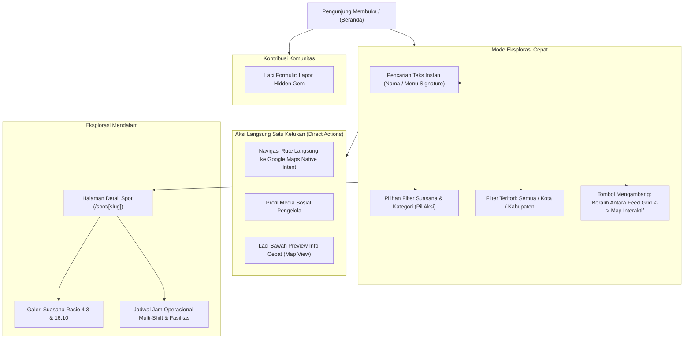

# Desain Sistem & Antarmuka: VisitPekalongan

Dokumen ini mendefinisikan rancangan alur antarmuka pengguna, kontrak data transfer (*DTO / API Contracts*), logika bisnis penentu status operasional, serta spesifikasi token desain visual untuk platform **VisitPekalongan**.

Untuk spesifikasi skema basis data dan kamus data relasional, silakan merujuk pada [`docs/database.md`](file:///c:/projects/visitpekalongan/docs/database.md).

---

## 1. Alur Pengguna & Arsitektur Antarmuka (User Journey)

Aplikasi dirancang dengan prinsip eksplorasi instan tanpa distraksi (*frictionless exploration*), mengutamakan kenyamanan jempol pada layar ponsel:



---

## 2. Kontrak Data Antarmuka (DTO / TypeScript Interfaces)

Kontrak data dipisahkan secara ketat guna mencegah pemborosan bandwidth seluler, membedakan antara kebutuhan data ringan peta dan informasi lengkap ulasan.

### A. Data Penanda Peta Ringan (`SpotMapMarkerDTO`)
Khusus dikonsumsi oleh komponen peta interaktif MapLibre GL. Berukuran sangat kecil (< 15 KB untuk 100 titik) untuk menjamin kelancaran render grafis di ponsel kelas menengah:

```typescript
export interface SpotMapMarkerDTO {
  id: string;
  name: string;
  slug: string;
  categorySlug: string;
  regency: "kota" | "kabupaten";
  latitude: number;
  longitude: number;
  priceRange: "murah_meriah" | "terjangkau" | "kafe_spesial";
  isOpenNow: boolean;
  statusLabel: string;
}
```

### B. Data Kartu Feed Ringkas (`SpotListItemDTO`)
Digunakan untuk kartu feed pada tampilan grid:

```typescript
export interface SpotListItemDTO {
  id: string;
  name: string;
  slug: string;
  categoryName: string;
  categorySlug: string;
  regency: "kota" | "kabupaten";
  district: string;
  signatureDish?: string;
  priceRange: "murah_meriah" | "terjangkau" | "kafe_spesial";
  coverImageUrl: string;
  latitude: number;
  longitude: number;
  googleMapsIntentUrl: string; // https://www.google.com/maps/dir/?api=1&destination={lat},{lng}
  instagramAccount?: string;
  lifecycleStatus: "active" | "temporarily_closed" | "permanently_closed";
  isOpenNow: boolean;
  statusLabel: string; // "Buka hingga 22:00" atau "Tutup sementara - renovasi"
  vibeTags: string[];
}
```

### C. Data Halaman Detail Lengkap (`SpotDetailDTO`)
Informasi mendalam untuk rute `/spot/[slug]` dan preview laci bawah:

```typescript
export interface SpotDetailDTO extends SpotListItemDTO {
  description: string;
  bestTimeToVisit?: string;
  address: string;
  facilities: string[];
  galleryImages: {
    id: string;
    imageUrl: string;
    altText?: string;
  }[];
  weeklySchedule: Record<
    "monday" | "tuesday" | "wednesday" | "thursday" | "friday" | "saturday" | "sunday",
    {
      slots: { open: string; close: string }[];
      is_closed: boolean;
    }
  >;
  scheduleNotes?: string;
}
```

### D. Parameter Filter URL (`SpotFilterParams`)
Struktur parameter query yang disinkronkan oleh pustaka `nuqs`:

```typescript
export interface SpotFilterParams {
  q?: string;           // Kata kunci pencarian
  category?: string;    // Slug kategori
  vibe?: string;        // Slug tag suasana
  regency?: "kota" | "kabupaten"; // Filter teritori makro
  district?: string;    // Filter wilayah kecamatan
  openNow?: boolean;    // Filter hanya yang sedang buka saat ini
  view?: "list" | "map";// Mode tampilan aktif
  spot?: string;        // Slug spot yang sedang disorot di peta
}
```

---

## 3. Logika Bisnis & Utilitas Inti (Core Business Logic)

### A. Algoritma Dua Hari (*Two-Day Sliding Window*) untuk `isOpenNow`
Kuliner malam khas Pekalongan (seperti Kopi Tahlil) lazim beroperasi dari malam (misal Selasa 19:00) hingga dini hari berikutnya (Rabu 02:30). Pendekatan satu hari kalender akan salah mendeteksi tempat sebagai "Tutup" saat diakses hari Rabu pukul 01:30.

Algoritma yang diterapkan:
1. **Dapatkan Waktu Lokal Saat Ini:** Membaca waktu nyata zona WIB (UTC+7), misal: `currentDay = 'wednesday'`, `currentTime = '01:30'`.
2. **Periksa Shift Kemarin (Yesterday's Overflow Shift):**
   - Ambil jadwal hari kemarin (`tuesday`).
   - Cari slot yang memiliki `close < open` (menandakan operasional melewati tengah malam).
   - Jika ditemukan dan `currentTime < slot.close`, maka tempat dinyatakan **BUKA** (sebagai sisa shift malam kemarin).
3. **Periksa Shift Hari Ini (Today's Active Shifts):**
   - Jika shift kemarin tidak aktif, periksa slot hari ini (`wednesday`).
   - Cocokkan apakah `currentTime >= slot.open` dan `currentTime < slot.close` (untuk slot normal pada hari yang sama).
   - Jika `slot.close < slot.open`, cocokkan apakah `currentTime >= slot.open`.
4. **Periksa Status Siklus Hidup:**
   - Jika `lifecycle_status === 'temporarily_closed'`, kalkulasi otomatis diabaikan dan status langsung ditetapkan sebagai "Tutup Sementara".

### B. Penanganan Zero-Result State (Empty State Cerdas)
Jika kombinasi filter multivariabel menghasilkan himpunan kosong (misal: Wisata Alam + Pekalongan Utara + Buka Sekarang pada jam 23:00):
- Tampilkan visual ilustrasi minimalis bertema gerabah lokal.
- Sediakan tombol aksi satu ketukan untuk melonggarkan filter secara bertahap:
  1. *"Hapus filter buka sekarang"*
  2. *"Lihat semua rekomendasi di kawasan ini"*
  3. *"Reset seluruh filter"*

### C. Navigasi Rute Langsung (Native Intent)
Tombol rute tidak menggunakan tautan web pendek Google Maps generik yang membuka tab browser baru, melainkan format standar URI intent:
```
https://www.google.com/maps/dir/?api=1&destination=${latitude},${longitude}
```
Format ini menjamin peramban ponsel langsung meluncurkan aplikasi native Google Maps dengan rute presisi menuju titik koordinat spot.

---

## 4. Token Desain Sistem Visual (Design System Tokens)

Identitas visual mengusung filosofi *Warm Artisanal Mori with Architectural Rigor*, terinspirasi dari warna kain mori batik mentah, keramik gerabah lokal, dan ketegasan garis presisi kriya. Untuk spesifikasi arsitektur token tiga lapis (*primitive, semantic, component*) dan skala tipografi lengkap, silakan merujuk pada [`DESIGN.md`](file:///c:/projects/visitpekalongan/DESIGN.md).

### A. Palet Warna Terkalibrasi Kontras (WCAG AA Compliant)

Didefinisikan langsung di dalam berkas CSS utama (`src/app/globals.css`) dengan Tailwind CSS v4 `@theme`:

```css
@theme {
  /* Kanvas & Latar Belakang Permukaan */
  --color-canvas: #F7F5F0;          /* Mori mentah / Linen hangat alami */
  --color-surface: #FAF8F5;         /* Clay krem lembut untuk bidang kartu */
  --color-surface-pure: #FFFFFF;    /* Putih bersih aksen */

  /* Tipografi Berkarakter */
  --color-text-primary: #242220;    /* Charcoal hangat alami (kontras 14.2:1) */
  --color-text-muted: #6E6963;      /* Driftwood abu tanah (kontras 4.99:1 - PASS WCAG AA) */
  --color-border: #DDD6CA;          /* Garis pembatas grout gerabah terdefinisi */
  --color-border-subtle: #E8E3DA;   /* Garis pembatas halus */

  /* Aksen Berakar Budaya (Terkalibrasi Kontras) */
  --color-accent-terracotta: #A8472B; /* Merah bata teks terkalibrasi (kontras 5.05:1 - PASS WCAG AA) */
  --color-accent-terracotta-raw: #C86446; /* Merah bata mentah (khusus background badge teks putih) */
  --color-accent-sage: #5A6B5C;       /* Hijau kabut pegunungan Petungkriyono */
  --color-accent-roast: #8C5A3C;      /* Cokelat seduhan biji kopi */
  
  /* Lencana Status Fungsional (Terkalibrasi Kontras) */
  --color-status-open: #3E6D4B;       /* Hijau daun terkalibrasi (kontras 4.85:1 - PASS WCAG AA) */
  --color-status-closed: #9E5345;     /* Merah tanah liat tua (kontras 5.2:1 - PASS WCAG AA) */

  /* Sistem Radius Kriya Terstruktur */
  --radius-card: 8px;                 /* Sudut kartu rapi terbingkai */
  --radius-button: 6px;               /* Tombol utilitas fungsional */
  --radius-badge: 4px;                /* Lencana stempel persegi lembut (anti-pill) */
  --radius-drawer: 12px;              /* Laci bawah preview peta */
}
```

### B. Pasangan Tipografi

- **Editorial Display & Headline:** `Instrument Serif` (Google Fonts).
  Memberikan sentuhan jurnal kurasi artisanal yang anggun pada judul situs dan nama tempat di halaman ulasan.
- **Body & Komponen Antarmuka:** `Plus Jakarta Sans` (Google Fonts).
  Menghadirkan keterbacaan yang tajam, modern, dan nyaman untuk navigasi, jam operasional, serta label filter pada layar ponsel.

### C. Spesifikasi Elemen Visual

- **Sudut Lengkung Ramping (Border Radius 6px - 8px):**
  Menggunakan sudut rapi terstruktur (8px untuk kartu, 6px untuk tombol, 4px untuk lencana). Menghindari bentuk kapsul seragam (*anti-pill obsession*) pada seluruh elemen antarmuka.
- **Lencana Stempel Persegi Lembut (Ceramic Stamp Badges):**
  Lencana dirancang dengan latar belakang lembut dan garis tepi tipis, menyerupai stempel tera arsip dan cap batik tradisional.
- **Elevasi & Bayangan (Shadow System):**
  Menggunakan bayangan hangat berbasis pigmen tanah:
  `box-shadow: 0 2px 8px -2px rgba(36, 34, 32, 0.05), 0 4px 16px -4px rgba(36, 34, 32, 0.08);`
  Menghasilkan kesan kartu yang berpijak alami di atas kanvas mori tanpa efek mengambang berlebihan.
